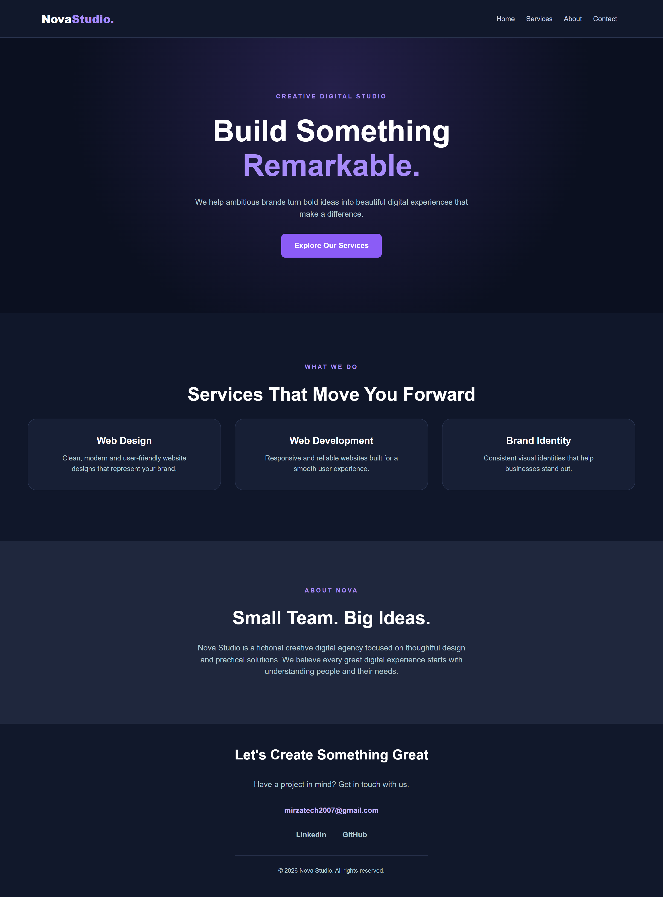
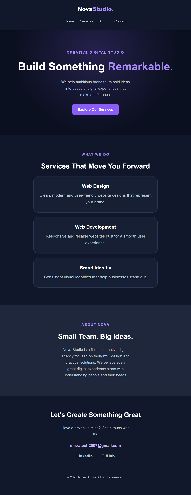
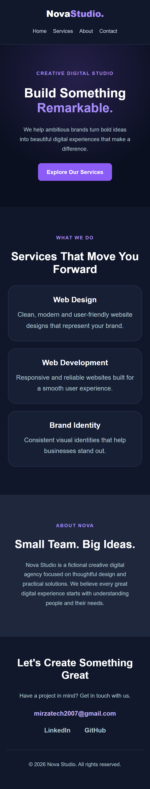

# Nova Studio — Landing Page

**Oasis Infobyte Internship (SIP) | Track: Web Development & Designing | Level 1 – Task 1**

A responsive, static landing page for **Nova Studio**, a fictional creative digital agency. Built with HTML5 and CSS3 as part of the Oasis Infobyte internship program.

## Demo

- Demo video (LinkedIn): https://lnkd.in/p/dmqPQTeU

## Screenshots

### Desktop (1440px)


### Tablet (768px)


### Mobile (375px)


## Features

- Sticky navigation bar with 4 links (Home, Services, About, Contact)
- Hero section with a headline, subheadline and a call-to-action button
- Two content sections: **Services** (3 cards) and **About**
- Footer with contact and social links
- Consistent dark-purple colour palette across all sections
- Smooth scrolling between sections
- Fully responsive layout using CSS Flexbox and Grid
- Hover effects on links, buttons and service cards

## Task Requirements Checklist

| Requirement | Status |
|-------------|--------|
| Fixed or sticky navigation bar with at least 3 links | Done (sticky, 4 links) |
| Hero section with headline, subheadline and CTA button | Done |
| At least 2 distinct content sections | Done (Services, About) |
| Footer with placeholder contact/social links | Done |
| Consistent colour palette | Done |
| Responsive layout using Flexbox or Grid | Done |
| No element overlap, intentional padding, margin and box-sizing | Done (`box-sizing: border-box` set globally) |
| Clean typography with at least 2 font sizes | Done (headings and body text) |

## Tech Stack

- HTML5
- CSS3 (Flexbox, Grid, media queries, transitions)
- A small JavaScript snippet (optional, see below)

## Responsive Design

The layout was tested at 375px, 768px, 1000px and 1440px.

| Breakpoint | Behaviour |
|------------|-----------|
| Above 900px | Three service cards in one row |
| 900px and below | Service cards stack vertically |
| 768px and below | Navbar stacks vertically; font sizes and spacing are reduced |
| 480px and below | Extra adjustments for small phones |

## Note on JavaScript

This task does not require JavaScript. The only script on the page adds a `scrolled` class to the navbar after the user scrolls 50px, which slightly changes the navbar's background and shadow. The page works fully without it.

## Project Structure

```
WebDev-L1-LandingPage/
├── index.html
├── style.css
├── README.md
└── screenshots/
    ├── desktop.png
    ├── tablet.png
    └── mobile.png
```

## How to Run

1. Download or clone this repository.
2. Open the `WebDev-L1-LandingPage` folder.
3. Open `index.html` in any modern browser.

No installation or build step is needed.

## Author

**Ahmed Shahzad Mughal**
Web Development & Designing Intern, Oasis Infobyte
GitHub: https://github.com/zaryanmirza
LinkedIn: https://www.linkedin.com/in/ahmedshahzadmughal

## Acknowledgements

Nova Studio is a fictional brand created only for this internship task. Task requirements provided by Oasis Infobyte.

#oasisinfobyte #webdevelopment #internship